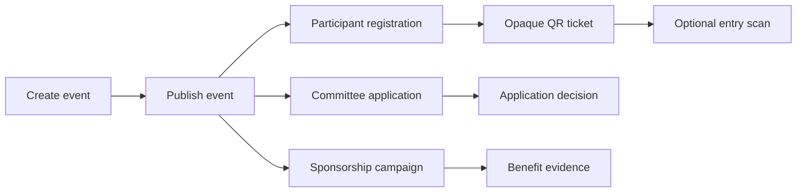

<div align="center">


# PartnerHub

### Event operations with sponsorship accountability

One workspace for event setup, reusable registration, committee recruitment, QR attendance, and sponsor benefit tracking.

[Product requirements](./PRD.md) · [Architecture](./ARCHITECTURE.md) · [Architecture essentials](./ARCHITECTURE-ESSETIALS.md) · [Venture concept](./Venture_Creation-2.md)

</div>

## Overview

PartnerHub is a Venture Creation concept for campus organizations, youth communities, and small event organizers that run recurring events. It aims to replace a fragmented mix of forms, spreadsheets, chat groups, ticket tools, and sponsorship files with one connected workspace.

The sponsorship workflow is the main differentiator. PartnerHub is not positioned as a national ticket marketplace, payment processor, generic CRM, or full HR system.

The `production` branch integrates the member branches into a classroom demo. It connects accounts, event creation/publication, participant registration, committee selection, QR tickets and optional entry/exit, sponsor decisions, and benefit reporting using fictional data in the browser. Real authentication, database-backed services, email, and payments remain **In progress**. See [delivery evidence](./DEMO-DELIVERY.md).

Run `npm run build:demo` then `npm start` for the hosted-demo build, or set `NEXT_PUBLIC_PARTNERHUB_DEMO=1` before `npm run dev`. Use the banner to switch between organizer, participant/applicant, and sponsor while retaining the same in-tab data. Open `/guide` for the demonstration sequence.

## Planned first-version flow



The first version is intended to demonstrate one complete event flow at a Venture Creation booth. Full scope and acceptance criteria live in [PRD.md](./PRD.md).

## Product boundaries

- Reusable profile data requires account-holder consent.
- Each account registers as one of three roles: user, organizer, or sponsor company. Organizer and sponsor accounts wait for admin verification and have limited access until approved. Event-level roles such as committee membership stay event-scoped.
- QR payloads contain an opaque ticket reference and secret, never personal data.
- Demo attendance can be disabled, entry-only, or entry and exit. Repeated scans preserve the first timestamps.
- Sponsorship uses proposal and evidence URLs. File uploads are deferred.
- Real payments, committee task boards, chat, sponsor matching, automatic matching notifications, and marketplace behavior are deferred.

## Current foundation

- Next.js 16 App Router scaffold with TypeScript and Tailwind CSS.
- Integrated account/workspace/event UI is available in the explicitly labeled classroom demo. Typed clients use the browser-only simulated service in that build; real authentication and backend persistence are not delivered.
- Four-stage event editing includes live poster/page preview, validation, module configuration, user-selected logos, and a publish-readiness checklist. The demo supports valid publication and event closure; real server storage remains **In progress**.
- Static `GET /api/health` route, not a database connectivity check.
- PostgreSQL and Prisma model for events, anonymous registrations, attendance, sponsorship campaigns, prospects, benefits, and timeline entries.
- Separate frontend and server-only backend ownership folders for account, event, registration, committee, attendance, and sponsorship work.
- Import-boundary lint rules and focused architecture tests.
- Product, architecture, and Venture Creation working documents.

The current schema does not yet implement reusable accounts or committee recruitment. Those changes are **In progress** and must not be treated as completed features.

## Technology

| Area | Tools |
| --- | --- |
| Interface and server routes | Next.js 16, React 19, TypeScript |
| Styling | Tailwind CSS 4 |
| Validation | Zod |
| Database and migrations | Supabase PostgreSQL, Prisma (connection In progress) |
| Quality checks | TypeScript, ESLint, Next.js build |
| Authentication | **In progress** |

## Repository structure

```text
PartnerHub/
├── PRD.md
├── ARCHITECTURE.md
├── ARCHITECTURE-ESSETIALS.md
├── AGENTS.md
├── prisma/
│   └── schema.prisma
├── src/
│   ├── app/
│   ├── features/
│   │   ├── attendance/
│   │   ├── account/
│   │   ├── committee/
│   │   ├── event/
│   │   ├── registration/
│   │   ├── sponsorship/
│   │   └── workspace/
│   ├── backend/         # Same product features, plus health and shared
│   ├── contracts/       # Agreed shared API types
│   └── lib/
└── tests/
```

## Run locally

```bash
npm install
npm run dev
```

Open `http://localhost:3000`.

Database-backed work is **In progress**. Copy `.env.example` to `.env` and provide Supabase PostgreSQL `DATABASE_URL`, migration `DIRECT_URL`, and the current secret peppers. Connection setup, including direct/session pooler guidance, is in `ARCHITECTURE.md`. No Supabase SDK or Auth is configured. Ordinary PostgreSQL also works by setting both URLs to its connection string.

```bash
npm run db:generate
npm run db:migrate
```

## Parallel development

Pick one feature and frontend, backend, or both. Root `AGENTS.md` requires agents to ask and confirm that scope before editing. Work in that feature's folders, its tests, and agreed page/API adapters on a separate branch and isolated checkout. Shared files and other features require separate approval.

Frontend code lives in `src/features/<feature>`; server logic lives in `src/backend/<feature>`. Do not import another feature's internals or backend modules from frontend code. Coordinate schema, shared contracts, and dependencies as infrastructure work.

```bash
npm run test:boundaries
npm run lint
npm run typecheck
npm run build
```

## Frontend integration (In progress)

Routes cover `/`, `/login`, `/register`, `/forgot-password`, `/reset-password`, `/verify-email`, `/onboarding`, `/dashboard`, `/settings`, `/events/new`, `/events/:id` and `/events/:id/edit`. Navy, larger licensed self-hosted typography and the yellow creation action are retained.

Feature services call typed cookie-session and event APIs. Those server routes do not exist yet: missing services produce explicit errors, never mock login or remote-save success. Happy-path browser verification intercepts APIs in tests only. Frontend guards are navigation UX, not authorization.

New event drafts can be incomplete when saved through their API contract. Logo selection supports PNG/JPEG/WebP, 2 MB and 4096px limits, preview and replacement. An explicit local-copy option retains the older complete-draft IndexedDB format and logo blobs; legacy v1 text drafts remain readable. Browser-wide copies are not account isolation or backup. Delete them after shared-device use.

Backend contracts/blockers: [todobackend.md](./todobackend.md). Direction: `DESIGN.md`. New flow, manual scenarios and local test evidence: [PRODUCT-FLOW-VERIFICATION.md](./tests/workspace/PRODUCT-FLOW-VERIFICATION.md). Earlier state-navigation workspace evidence is historical.

```bash
# Node 22.18+ or Node 24 for native TypeScript loading
node --test tests/account/*.test.mjs tests/event/*.test.mjs tests/workspace/*.test.mjs
```

Browser checks use an externally installed Playwright module and Edge, without adding a project dependency. See the verification document for setup.

## Validation status

The expanded event-operations concept has not yet been validated through owned interviews, usability tests, paid usage, or revenue. Planned research includes organizer interviews, participant registration tests, committee application review, a small QR check-in test, and sponsorship workflow feedback.

The current scaffold has previously passed:

```bash
npm run db:generate
npm run typecheck
npm run lint
npm run build
```

Documentation changes in this revision do not prove the planned product features. Feature-level unit, integration, and end-to-end tests remain **In progress**.

## Source documents

- [Business concept and first-version scope](./Venture_Creation-2.md)
- [Opportunity assessment](./Venture_Creation-3.md)
- [Key idea, product, and market](./Venture_Creation-4.md)

The public LOKET creator page cited in the Venture document is competitor and market context only. It is not evidence of PartnerHub demand, traction, or revenue.

## License

Application license decision is **In progress**. Bundled Bricolage Grotesque and Manrope fonts use SIL Open Font Licenses, included in `src/features/workspace/fonts`. No external participant dataset is included.
